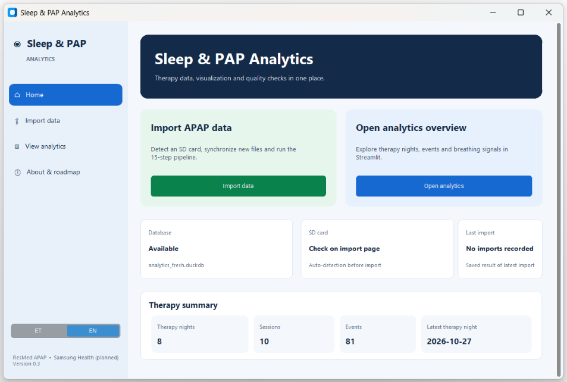
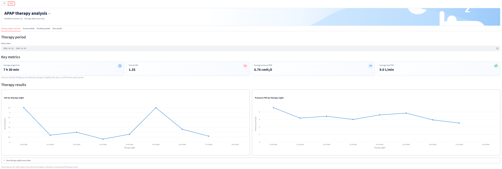
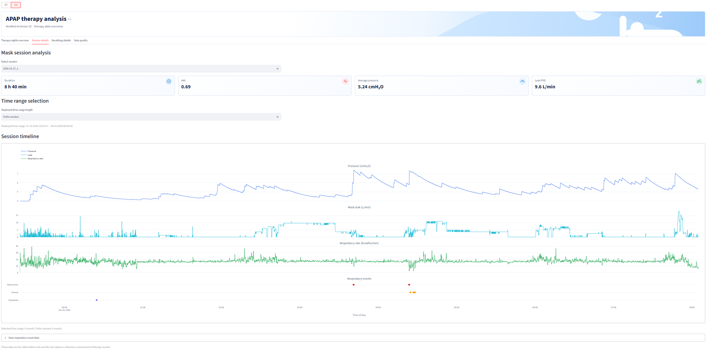
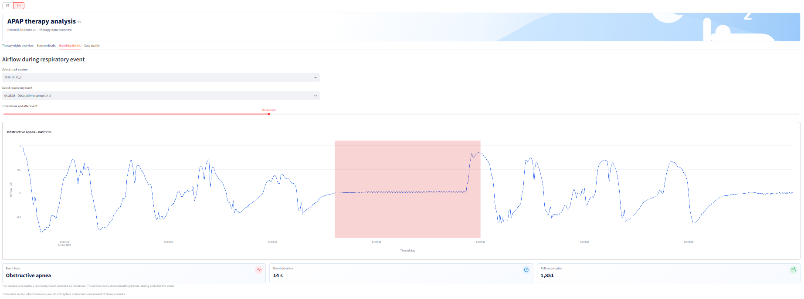
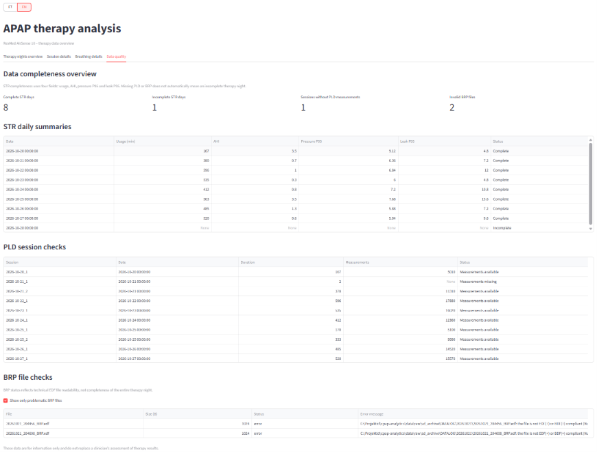
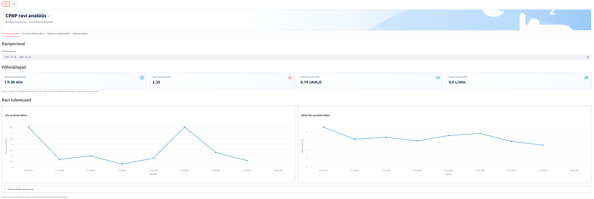
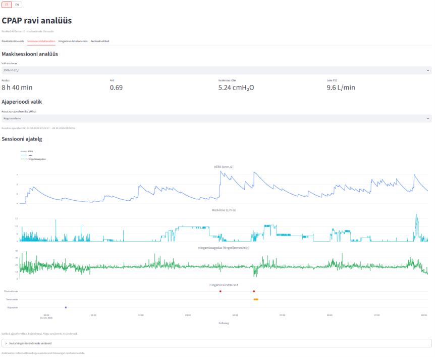
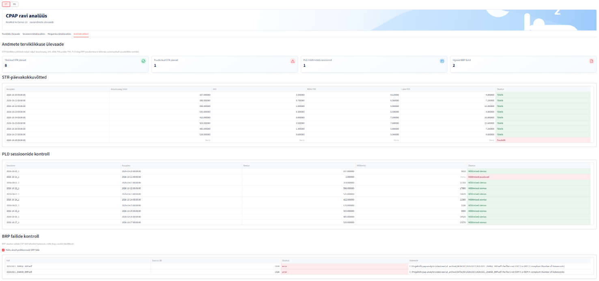

# APAP Analytics

**Local APAP therapy data processing, data-quality checks, and interactive analysis.**

**Language / Keel:** [English](#english) · [Eesti keeles](#eesti-keeles)

> **Status:** Local data-processing pipeline, bilingual four-tab dashboard, synthetic demo dataset, and demo/personal data-mode selection are implemented and tested locally. A publicly hosted web demo and installation testing on a clean machine are still planned.
>
> **Data:** The included demo dataset is synthetic. The screenshots illustrate the application using real local measurements; personal therapy recordings and analysis databases are stored and processed locally.
>
> **Medical disclaimer:** This is an exploratory analytics project. It does not provide diagnosis or treatment recommendations.

---

<a id="english"></a>
## English

### Project overview

APAP Analytics is a Python project for processing and exploring therapy data recorded by a ResMed APAP device. It imports locally available device files, validates and transforms the data, stores analytical results in DuckDB, and displays them in an interactive Streamlit dashboard.

The project serves two purposes: a local tool for analyzing one's own authorized therapy records, and a GitHub portfolio project demonstrating data ingestion, transformation, data-quality controls, analytical modeling, and visualization.

### Application preview

The following screenshots show the **actual Windows application and Streamlit interface**. The analytics screenshots were captured from a **local dataset of real APAP measurements**, not the included synthetic dataset. They illustrate the capabilities of the application; **the included demo mode uses synthetic data only**.

#### Windows launcher

The desktop launcher provides access to SD-card import, the analytics dashboard, data-mode selection, and an overview of the locally available data.



#### 1. Therapy nights overview

An overview of therapy usage and key indicators, including AHI, pressure P95, and leak P95, with nightly trends and selectable dates.



#### 2. Session details

A session-level timeline combining therapy pressure, mask leak, respiratory rate, and respiratory events. This enables drill-down from nightly metrics to individual sessions.



#### 3. Breathing details

Detailed airflow surrounding a selected respiratory event, when a corresponding BRP recording exists. The highlighted interval identifies the detected event.



#### 4. Data quality

Completeness checks across daily summaries, detailed PLD measurements, and BRP files. Missing measurements and file-reading errors are surfaced explicitly instead of being silently ignored.



*The screenshots use real local measurements; the runnable demo uses synthetic data. No personal recordings or databases are included in the repository.*

### Current features

- Local SD-card import and processing pipeline for therapy summaries, mask-use sessions, respiratory events, and detailed EDF recordings.
- DuckDB analytical storage and Parquet-based processing where applicable.
- Session-level metrics and matching respiratory events to mask-use sessions.
- Data-quality checks for missing summary values, unavailable detailed measurements, and BRP file status.
- Bilingual Estonian/English Streamlit dashboard with four tabs:
  1. **Therapy Night Overview** — nightly usage and key therapy indicators.
  2. **Session Detail Analysis** — session-level metrics and respiratory events.
  3. **Breathing Detail Analysis** — detailed measurements and airflow visualizations where recordings are available.
  4. **Data Quality** — completeness, file status, and warnings.
- Two data modes: **demo** (included synthetic data) and **personal** (locally imported device data).
- Windows graphical launcher with explicit demo/personal selection, plus an SD-card update helper.

### Data flow

```text
ResMed SD card / local archive          Included synthetic demo data
               |                                     |
               v                                     |
     Python import and processing                    |
               |                                     |
               v                                     |
     Validation and derived metrics                  |
               |                                     |
               v                                     v
        Local DuckDB                         Demo DuckDB + EDF files
               |                                     |
               +------------------+------------------+
                                  |
                                  v
                         Streamlit dashboard
```

The personal-data pipeline is orchestrated by `src/pipeline.py`. The dashboard entry point is `dashboard/app.py`. The synthetic dataset can be recreated with `demo/generate_demo_data.py`.

### Included synthetic demo data

The repository includes an independently generated demonstration dataset:

| Data | Quantity |
|---|---:|
| Therapy nights | 30 |
| Mask-use sessions | 33 |
| Respiratory events | 473 |
| PLD measurements | 74,040 |
| BRP EDF files | 4 |

The included demo files are:

```text
demo/
  generate_demo_data.py
  data/
    apap_demo.duckdb
    brp/
      demo_01_BRP.edf
      demo_02_BRP.edf
      demo_03_BRP.edf
      demo_04_BRP.edf
    pld/
      synthetic_pld.parquet
```

**Demo limitations:** All demo values and breathing signals are synthetic and not clinically validated. Airflow signals are simplified illustrations, not faithful reproductions of real APAP recordings. Only selected events have corresponding BRP airflow recordings, so many events will not display a detailed breathing graph. Demo data must not be compared with real therapy data at a fine-grained physiological or clinical level. The demo is intended to demonstrate the application's workflow, calculations, data-quality handling, and visualization features.

### Project layout

```text
src/                  Data import, transformation, validation, and pipeline
dashboard/            Streamlit application
docs/images/en/       English application screenshots
docs/images/et/       Estonian application screenshots
demo/                 Synthetic-data generator and included demo dataset
tests/                Test fixtures and supporting files
app_launcher.py       Windows graphical launcher
APAP Analytics.vbs    Windows launcher helper
update_apap.bat       SD-card update helper (Windows)
requirements.txt      Python dependencies
requirements-lock.txt Dependency lock/reference file
README.md             Project documentation
```

The included demo files are located in `demo/data/`, while application screenshots are in `docs/images/`. Personal therapy data is processed and stored locally.

### Local setup (Windows)

Python 3.11 was used in the development environment. Run the following commands from the project root:

```powershell
python -m venv .venv
.\.venv\Scripts\Activate.ps1
python -m pip install -r requirements.txt
```

Installation and end-to-end operation on a clean machine have not yet been independently verified.

### Launching the dashboard

**Demo mode (default):** uses the included synthetic dataset. No personal device files are needed.

```powershell
$env:APAP_DATA_MODE = "demo"
python -m streamlit run dashboard/app.py
```

**Personal mode:** uses the local analytical database created from the user's own authorized APAP recordings.

```powershell
$env:APAP_DATA_MODE = "personal"
python -m streamlit run dashboard/app.py
```

If `APAP_DATA_MODE` is not set, the dashboard defaults to demo mode. The PowerShell environment variable persists for the current terminal session; set it explicitly when changing modes. Stop the existing Streamlit server before switching data sources.

**Windows graphical launcher:** run `python app_launcher.py` or open `APAP Analytics.vbs` after installing the local virtual environment. On the analytics page, choose **Demo Data** or **Personal Data**. The launcher passes the chosen mode to Streamlit. Stop the currently running dashboard before opening another mode; the launcher checks whether port 8501 is already in use.

### Importing personal APAP data

The personal mode does **not** access the project author's data. Each user must process their own authorized device files locally.

On Windows, run `update_apap.bat` and enter the SD card drive letter when prompted. The script invokes `src/pipeline.py` with the selected card path. Alternatively, use the graphical launcher's import function. The resulting local database is expected at `data/pipeline_test/analytics_fresh.duckdb`.

Do not run the import while the dashboard has the database open. The personal import workflow depends on the device's file structure and has not yet been validated on other users' devices.

### Data privacy

The included demo uses independently generated synthetic data. Personal therapy recordings and analysis databases are stored and processed locally. The screenshots above illustrate real local measurements but are not part of the runnable demo dataset.

### Roadmap

- [x] Local data import and analytical pipeline
- [x] Four-tab bilingual Streamlit dashboard
- [x] Data-quality overview
- [x] Independently generated synthetic dataset
- [x] Demo/personal data-source selection
- [x] Portable demo data files for local use
- [x] Windows launcher with explicit data-mode selection
- [ ] Clean-environment installation and end-to-end test
- [ ] Publicly hosted Streamlit web demo
- [x] Bilingual application screenshots (real local measurements; no raw recordings shared)
- [ ] Possible future exploration: Samsung Health integration and an AI analysis assistant

---

<a id="eesti-keeles"></a>
## Eesti keeles

[Back to English / Tagasi ingliskeelse osa juurde](#english)

### Projekti ülevaade

APAP Analytics on Pythonis loodud projekt ResMedi APAP-seadme salvestatud raviandmete töötlemiseks ja analüüsimiseks. Rakendus impordib lokaalselt kättesaadavaid seadmefaile, kontrollib ja teisendab andmeid, salvestab analüütilised tulemused DuckDB andmebaasi ning kuvab need interaktiivsel Streamliti juhtpaneelil.

Projektil on kaks eesmärki: analüüsivahend seadme andmete uurimiseks ning GitHubi portfooliotöö, mis näitab andmete laadimise, teisendamise, kvaliteedikontrolli, analüütilise modelleerimise ja visualiseerimise poolt.

Rakendus ei anna diagnoose või ravisoovitusi. Tulemuste tõlgendamisel tuleb arvestada meditsiinilise kontekstiga.

### Rakenduse visuaalne tutvustus

Järgmised ekraanipildid näitavad **tegelikku Windowsi rakendust ja Streamliti juhtpaneeli**. Analüüsivaadete pildid on tehtud **tegelikel APAP-mõõtmistel põhinevast lokaalsest andmestikust**, mitte kaasasolevatest sünteetilistest näidisandmetest. Need tutvustavad rakenduse võimalusi; **projektiga kaasas olev demorežiim kasutab ainult sünteetilist andmestikku**.

#### Windowsi käivitusrakendus

Graafiline käivitusrakendus võimaldab importida SD-kaardi andmeid, avada analüüsi, valida andmerežiimi ja vaadata kohaliku andmestiku lühikokkuvõtet.


#### 1. Raviööde ülevaade

Raviperioodi kasutusaja ning peamiste näitajate (AHI, rõhk P95 ja leke P95) ülevaade koos öiste trendide ja kuupäevavalikuga.



#### 2. Sessiooni detailanalüüs

Sessiooni ajajoonel on kõrvuti rõhk, maskileke, hingamissagedus ja hingamissündmused. See võimaldab liikuda öiste koondnäitajate juurest üksiku sessiooni detailidesse.



#### 3. Hingamise detailanalüüs

Valitud hingamissündmuse ümbruse õhuvoolusignaal, kui vastav BRP-salvestis on olemas. Esiletõstetud lõik näitab tuvastatud sündmuse kestust.


#### 4. Andmekvaliteet

Päevakokkuvõtete, PLD-detailmõõtmiste ja BRP-failide täielikkuse kontroll. Puuduvad mõõtmised ning failide lugemise vead tuuakse eraldi esile.



*Ekraanipildid põhinevad tegelikel lokaalsetel mõõtmistel; käivitatav demo kasutab sünteetilisi andmeid. Isiklikke salvestisi ja andmebaase repositoorium ei sisalda.*

### Praegune funktsionaalsus

- SD-kaardi andmete lokaalne import ja töötlus: raviööde kokkuvõtted, maskisessioonid, hingamissündmused ja EDF-detailfailid.
- Analüütiliste andmete salvestamine DuckDB-sse ning vajaduse korral Parquet-failide kasutamine.
- Sessioonipõhised mõõdikud ja hingamissündmuste sidumine maskisessioonidega.
- Andmekvaliteedi kontrollid puuduvate kokkuvõttenäitajate, detailmõõtmiste ja BRP-failide seisundi kohta.
- Eesti- ja ingliskeelne Streamliti juhtpaneel nelja vahelehega:
  1. **Raviööde ülevaade** – öine kasutusaeg ja peamised ravinäitajad.
  2. **Sessiooni detailanalüüs** – sessioonipõhised mõõdikud ja hingamissündmused.
  3. **Hingamise detailanalüüs** – detailmõõtmised ja õhuvoolugraafikud, kui salvestised on olemas.
  4. **Andmekvaliteet** – andmete täielikkus, failide seisund ja hoiatused.
- Kaks andmerežiimi: **demo** (kaasasolevad sünteetilised andmed) ja **personal** (kasutaja enda imporditud andmed).
- Windowsi graafiline käivitusrakendus selge demo-/personal-valikuga ning SD-kaardi uuendamise abiskript.

### Andmetöötluse töövoog

```text
ResMedi SD-kaart / lokaalne arhiiv       Kaasasolevad sünteetilised demoandmed
               |                                     |
               v                                     |
     Pythoniga import ja töötlus                     |
               |                                     |
               v                                     |
     Kontrollid ja arvutused                         |
               |                                     |
               v                                     v
        Lokaalne DuckDB                      Demo DuckDB + EDF-failid
               |                                     |
               +------------------+------------------+
                                  |
                                  v
                         Streamliti juhtpaneel
```

Isiklike andmete töötlust juhib `src/pipeline.py`. Juhtpaneeli põhifail on `dashboard/app.py`. Sünteetilise andmestiku saab uuesti luua skriptiga `demo/generate_demo_data.py`.

### Kaasasolevad sünteetilised demoandmed

Repositoorium sisaldab sõltumatult genereeritud näidisandmestikku:

| Andmed | Kogus |
|---|---:|
| Raviöid | 30 |
| Maskisessioone | 33 |
| Hingamissündmusi | 473 |
| PLD-mõõtmisi | 74 040 |
| BRP EDF-faile | 4 |

Demoandmete failid:

```text
demo/
  generate_demo_data.py
  data/
    apap_demo.duckdb
    brp/
      demo_01_BRP.edf
      demo_02_BRP.edf
      demo_03_BRP.edf
      demo_04_BRP.edf
    pld/
      synthetic_pld.parquet
```

**Demoandmete piirangud:** Kõik demoandmed ja hingamissignaalid on sünteetilised ega ole kliiniliselt valideeritud. Õhuvoolusignaalid on lihtsustatud illustratsioonid, mitte tegelike APAP-salvestiste täpsed jäljendused. BRP-detailandmed on olemas ainult valitud sündmuste kohta, mistõttu paljude sündmuste juures detailset hingamisgraafikut ei kuvata. Demoandmeid ei saa füsioloogilise detailsuse ega kliinilise tähenduse poolest otseselt võrrelda tegelike raviandmetega. Näidisandmestiku eesmärk on tutvustada rakenduse töövoogu, arvutusi, andmekvaliteedi käsitlemist ja visualiseerimist.

### Projekti ülesehitus

```text
src/                  Andmete import, teisendamine, kontrollid ja pipeline
dashboard/            Streamliti rakendus
docs/images/en/       Ingliskeelsed ekraanipildid
docs/images/et/       Eestikeelsed ekraanipildid
demo/                 Sünteetiliste andmete generaator ja näidisandmestik
tests/                Testfailid ja abimaterjalid
app_launcher.py       Windowsi graafiline käivitusrakendus
APAP Analytics.vbs    Windowsi käivitamise abiskript
update_apap.bat       SD-kaardi andmete uuendamise abiskript
requirements.txt      Pythoni sõltuvused
requirements-lock.txt Sõltuvuste lukustus-/viitefail
README.md             Projekti dokumentatsioon
```

Kaasasolevad demoandmed asuvad kaustas `demo/data/` ning rakenduse ekraanipildid kaustas `docs/images/`. Isiklikke raviandmeid töödeldakse ja säilitatakse lokaalselt.

### Paigaldamine (Windows)

Arenduskeskkonnas kasutati Python 3.11 versiooni. Käivita projekti juurkaustas:

```powershell
python -m venv .venv
.\.venv\Scripts\Activate.ps1
python -m pip install -r requirements.txt
```

Paigaldamist ja kogu töövoogu teises, puhtas arvutikeskkonnas ei ole veel eraldi kontrollitud.

### Juhtpaneeli käivitamine

**Demorežiim (vaikimisi):** kasutab projektiga kaasas olevat sünteetilist andmestikku. Isiklikke seadmefaile pole vaja.

```powershell
$env:APAP_DATA_MODE = "demo"
python -m streamlit run dashboard/app.py
```

**Isiklike andmete režiim:** kasutab kasutaja enda APAP-andmetest loodud lokaalset analüütilist andmebaasi.

```powershell
$env:APAP_DATA_MODE = "personal"
python -m streamlit run dashboard/app.py
```

Kui `APAP_DATA_MODE` pole määratud, avaneb vaikimisi demorežiim. PowerShellis jääb keskkonnamuutuja väärtus aktiivseks sama terminaliseansi jooksul; režiimi vahetamisel määra väärtus uuesti. Enne andmeallika vahetamist peata töötav Streamliti server.

**Windowsi graafiline käivitusrakendus:** käivita `python app_launcher.py` või ava `APAP Analytics.vbs` pärast virtuaalkeskkonna paigaldamist. Andmete vaatamise lehel vali **„Ava demoandmed”** või **„Ava isiklikud andmed”**. Käivitusrakendus edastab valitud režiimi Streamlitile. Enne teise režiimi avamist tuleb eelmine dashboard peatada; rakendus kontrollib ka pordi 8501 hõivatust.

### Isiklike APAP-andmete import

Personal-režiim **ei anna ligipääsu projekti autori andmetele**. Iga kasutaja peab oma seadme andmed ise lokaalselt töötlema.

Windowsis käivita `update_apap.bat` ja sisesta küsimise peale SD-kaardi kettatäht. Skript käivitab `src/pipeline.py` valitud kaardiga. Alternatiivina saab kasutada graafilise käivitusrakenduse impordifunktsiooni. Loodud lokaalse andmebaasi eeldatav asukoht on `data/pipeline_test/analytics_fresh.duckdb`.

Ära käivita importi ajal, mil dashboard hoiab andmebaasi avatuna. Isiklike andmete import sõltub seadme failistruktuurist ning seda ei ole veel teiste kasutajate seadmetega kontrollitud.

### Andmete privaatsus

Kaasasolev demo kasutab sõltumatult genereeritud sünteetilisi andmeid. Isiklikke raviandmeid ja analüüsiandmebaase säilitatakse ning töödeldakse lokaalselt. Ülal olevad ekraanipildid illustreerivad tegelikke kohalikke mõõtmisi, kuid ei kuulu käivitatava demo andmestikku.

### Edasine arendusplaan

- [x] Lokaalne andmete import ja analüüsipipeline
- [x] Nelja vahelehega kakskeelne Streamliti juhtpaneel
- [x] Andmekvaliteedi ülevaade
- [x] Sõltumatult genereeritud sünteetiline andmestik
- [x] Demo-/personal-andmeallika valik
- [x] Teisaldatavad demoandmete failid kohalikuks kasutamiseks
- [x] Windowsi käivitusrakendus selge andmerežiimi valikuga
- [ ] Paigaldamise ja kogu töövoo test puhtas keskkonnas
- [ ] Avalik Streamliti veebidemo
- [x] Kakskeelsed rakenduse ekraanipildid (tegelikud lokaalsed mõõtmised; toorsalvestisi ei jagata)
- [ ] Võimalikud tulevased täiendused: Samsung Healthi andmed ja AI-analüüsiagent
